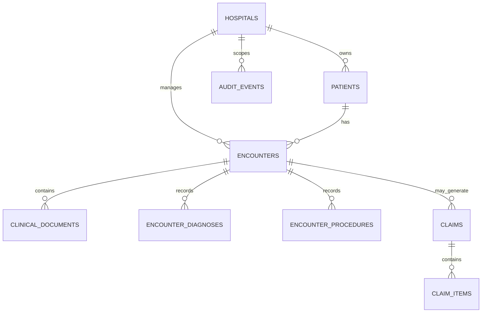

# HCI Core Data Model (Draft v0.1)

This model is a starting point for a Laravel 12 application using MySQL 8.4. It is not yet a production schema. Review it with hospital medical-record, coding, claim, security and legal stakeholders before importing real data.

## Design principles
- Multi-hospital isolation: every operational record is scoped to a hospital.
- Internal identifiers: use generated UUIDs; do not use NIK, BPJS number or medical-record number as primary keys.
- Source provenance: retain source system, source record key and source timestamps.
- Human review: AI output is a proposal with status, evidence and reviewer; it never silently becomes a final clinical fact.
- Versioning: coding references and claim rules must carry source/version/effective dates in later modules.
- Auditability: sensitive reads and all material writes should produce audit events.

## Core entities
- hospitals: tenant boundary and facility metadata.
- patients: hospital-scoped patient identity mapping; direct identifiers are intentionally excluded from this first schema.
- encounters: outpatient/inpatient/emergency episode.
- clinical_documents: metadata and protected storage pointer; never store raw clinical files in Git or public object storage.
- encounter_diagnoses / encounter_procedures: source-linked clinical statements and review state.
- claims: claim lifecycle and grouping status, not a replacement for official BPJS systems.
- claim_items: diagnosis/procedure references associated with a claim.
- audit_events: append-only activity record.

## Relationship overview

## Status vocabulary
- clinical/coding review: `pending`, `accepted`, `rejected`, `amended`.
- claim workflow: `draft`, `review`, `ready_for_submission`, `submitted`, `returned`, `accepted`, `cancelled`.
- AI recommendation: keep in a separate recommendation table/module; do not overload clinical fact tables with unreviewed model output.

## Important implementation notes
- Add Laravel authentication and a hospital membership/role layer before exposing endpoints.
- Enforce hospital scope in policies/services, not only in UI filters.
- Encrypt storage and use short-lived authorized download URLs for documents.
- Do not put patient names, NIK, BPJS numbers, diagnoses or documents in application logs.
- Add retention, consent/legal-basis, access-break-glass and correction workflows based on hospital policy.
- This draft omits national identifiers and detailed claim payloads intentionally.
